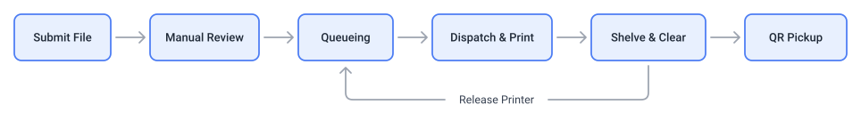
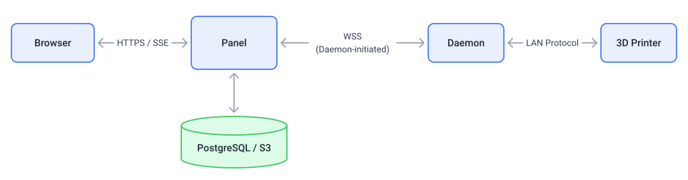

<div align="center">

# PlateRelay

[![Contract CI][ci-shield]][ci-url]
[![Status][status-shield]][status-url]
[![Last Commit][last-commit-shield]][last-commit-url]
[![Stargazers][stars-shield]][stars-url]
[![Issues][issues-shield]][issues-url]
[![PRs Welcome][prs-shield]][prs-url]
[![License][license-shield]][license-url]

An open-source, self-hosted 3D printing platform for shared-printer environments such as hackathons, makerspaces, and university labs—combining centralized multi-printer management with auditable review, scheduling, and fulfillment workflows while isolating users from physical hardware.

[Getting Started](#getting-started) · [Roadmap](#roadmap) · [Report Bug](https://github.com/TomChicken-on-github/PlateRelay/issues/new) · [Request Feature](https://github.com/TomChicken-on-github/PlateRelay/issues/new)

**English** · [简体中文](README.zh-CN.md)

</div>

<details>
  <summary>Table of Contents</summary>
  <ol>
    <li>
      <a href="#about-the-project">About The Project</a>
      <ul>
        <li><a href="#built-with">Built With</a></li>
        <li><a href="#repository-structure">Repository Structure</a></li>
      </ul>
    </li>
    <li>
      <a href="#getting-started">Getting Started</a>
      <ul>
        <li><a href="#deployment">Deployment</a></li>
        <li><a href="#local-development">Local Development</a></li>
      </ul>
    </li>
    <li><a href="#roadmap">Roadmap</a></li>
    <li>
      <a href="#contributing">Contributing</a>
      <ul>
        <li><a href="#contributors">Contributors</a></li>
      </ul>
    </li>
    <li><a href="#license">License</a></li>
    <li><a href="#contact">Contact</a></li>
    <li><a href="#acknowledgments">Acknowledgments</a></li>
  </ol>
</details>

## About The Project

**PlateRelay** unifies centralized multi-printer management with a shared 3D printing workflow. Unlike traditional print farm systems designed for single-owner private fleets, PlateRelay is built specifically for shared public printing resources:

| Dimension | Traditional Print Farm | PlateRelay |
| --- | --- | --- |
| Resource Model | Single-owner private fleet | Shared public printing resources |
| Role Isolation | Internal staff operate printers directly | Regular users only submit print files and collect parts with pickup codes, isolated from physical hardware |
| Scheduling & Audit | Internal scheduling without review or audit trails | Manual review, rule-based queue scheduling, and full audit logging with permission-controlled visibility |
| Fulfillment Loop | Ends when printing finishes; no handoff or bed-clearance gate | Printers are released only after parts are shelved and bed clearance is confirmed, followed by QR-verified pickup |

<p align="center">
  <picture>
    <source media="(prefers-color-scheme: dark)" srcset="docs/assets/workflow-en-dark.svg">
    <source media="(prefers-color-scheme: light)" srcset="docs/assets/workflow-en-light.svg">
    
  </picture>
</p>

Architecturally, the platform separates the **management panel** from a **LAN daemon**: the daemon runs on the printer LAN and establishes an outbound connection to the panel, requiring no inbound LAN ports; a unified device adapter abstracts printer brands so core workflows remain vendor-agnostic.

<p align="center">
  <picture>
    <source media="(prefers-color-scheme: dark)" srcset="docs/assets/architecture-en-dark.svg">
    <source media="(prefers-color-scheme: light)" srcset="docs/assets/architecture-en-light.svg">
    
  </picture>
</p>

### Built With

[![NestJS][nestjs-shield]][nestjs-url]
[![Node.js][nodejs-shield]][nodejs-url]
[![TypeScript][typescript-shield]][typescript-url]
[![React][react-shield]][react-url]
[![Vite][vite-shield]][vite-url]
[![Tailwind CSS][tailwind-shield]][tailwind-url]
[![PostgreSQL][postgresql-shield]][postgresql-url]
[![Python][python-shield]][python-url]

### Repository Structure

| Directory | Description |
| --- | --- |
| [`apps/server`](apps/server/README.md) | Panel backend service (REST API, SSE updates, daemon control channel) |
| [`apps/web`](apps/web/README.md) | Panel web frontend (currently a local mock-data prototype) |
| [`daemon`](daemon/README.md) | LAN device daemon (`platerelay_daemon`) and built-in simulated printer (`platerelay_sim`) |
| [`packages/shared`](packages/shared/schema/openapi.yaml) | Cross-package shared types, OpenAPI specification, and daemon protocol contracts |
| `docs` | Design specifications, sequence diagrams, and hardware test captures |
| [`tools`](tools/printer_mcp/README.md) | Read-only hardware probing and debugging tools |

## Getting Started

### Deployment

PlateRelay is currently in early active development. Production release packages and a Docker Compose deployment stack are not yet published. For now, you can preview the frontend prototype locally or run the backend alongside the daemon and built-in simulated printer.

### Local Development

#### Prerequisites

- **Panel (Web & Server)**: Node.js `>= 24` and `pnpm` (local development defaults to embedded PGlite and local file storage, so no external database or object store is required)
- **Daemon & Simulated Printer (Optional)**: Python `>= 3.12` and `uv`

#### Installation

```sh
pnpm install
uv sync --project daemon   # Optional if running only the web frontend or server
```

#### Running Locally

Run from the repository root:

```sh
# Frontend prototype (uses local mock data, served at http://localhost:5173/ by default)
pnpm dev:web

# Panel backend (listens on :3000 by default)
pnpm dev:server
```

> [!NOTE]
> The panel backend has been rewritten against the latest API contracts, while `apps/web` is still being updated to match; `VITE_API=http` mode is temporarily unavailable. To run the panel server, simulated printer, and daemon together, see [apps/server/README.md](apps/server/README.md) and [daemon/README.md](daemon/README.md).

#### Running Tests

```sh
pnpm test                                   # Shared package and panel server tests
uv run --project daemon pytest daemon/tests # Daemon and simulated printer tests
```

## Roadmap

- [x] **Core Contracts & Foundation**: OpenAPI and daemon protocol contracts, core backend workflow engine, daemon framework, and built-in simulated printer
- [ ] **v1 Release**: Frontend contract integration, complete file safety validation, full Bambu Lab driver, camera/timelapse media pipeline, external auth & notifications, and Docker Compose deployment
- [ ] **Multi-Brand Printer Drivers**: Support for additional firmware and protocols such as Klipper / Moonraker, PrusaLink, and OctoPrint
- [ ] **Operations & Cost Management**: Finished-part staging shelf management, filament inventory tracking, usage analytics reports, and cost tracking
- [ ] **Open Integrations**: Public REST API enhancements, scoped personal access tokens (PAT), event webhooks, and extensible external authentication/notification adapters for event portals, campus systems, and community bots

## Contributing

Issues and pull requests are welcome. Before submitting changes, please keep the following in mind:

1. For API or daemon protocol changes, update the contract schemas under `packages/shared/schema/` first and regenerate derived code.
2. Ensure both `pnpm test` and `uv run --project daemon pytest daemon/tests` pass before opening a PR.
3. Never commit real printer access codes, private keys, tokens, or other credentials in code, configuration files, logs, or tests.

Standard workflow: Fork the repository → Create a feature branch (`git checkout -b feat/your-feature`) → Commit your changes → Open a Pull Request.

### Contributors

<p>
  <a href="https://github.com/TomChicken-on-github/PlateRelay/graphs/contributors">
    
  </a>
  
  
  <a href="https://github.com/belugaQAQ">
    
  </a>
  <a href="https://github.com/z4zhishi">
    
  </a>
</p>

## License

Copyright (C) 2026 Tom_Chicken

PlateRelay is free software, distributed under the GNU General Public License v3.0 only ([GPL-3.0-only](LICENSE)). This program comes with ABSOLUTELY NO WARRANTY; see the license file for details.

### Third-Party Code

| Component | Location | Copyright | License |
| --- | --- | --- | --- |
| `pybambu` from [ha-bambulab](https://github.com/greghesp/ha-bambulab) | [daemon/src/platerelay_daemon/adapters/bambu/_vendor/pybambu/](daemon/src/platerelay_daemon/adapters/bambu/_vendor/pybambu/) | Copyright (c) 2023 ha-bambulab contributors | MIT, see [LICENSE](daemon/src/platerelay_daemon/adapters/bambu/_vendor/pybambu/LICENSE) |

PlateRelay is not affiliated with Bambu Lab or the ha-bambulab project.

## Contact

- Issues & Feature Requests: [GitHub Issues](https://github.com/TomChicken-on-github/PlateRelay/issues)
- Repository: [TomChicken-on-github/PlateRelay](https://github.com/TomChicken-on-github/PlateRelay)

## Acknowledgments

- [ha-bambulab](https://github.com/greghesp/ha-bambulab) (`pybambu`)
- [Best-README-Template](https://github.com/othneildrew/Best-README-Template)

<!-- MARKDOWN LINKS & IMAGES -->
[ci-shield]: https://img.shields.io/github/actions/workflow/status/TomChicken-on-github/PlateRelay/contract.yml?branch=main&style=for-the-badge&logo=githubactions&logoColor=white&label=Contract%20CI
[ci-url]: https://github.com/TomChicken-on-github/PlateRelay/actions/workflows/contract.yml
[status-shield]: https://img.shields.io/badge/Status-Early%20Development-orange?style=for-the-badge
[status-url]: #roadmap
[last-commit-shield]: https://img.shields.io/github/last-commit/TomChicken-on-github/PlateRelay?style=for-the-badge
[last-commit-url]: https://github.com/TomChicken-on-github/PlateRelay/commits/main
[stars-shield]: https://img.shields.io/github/stars/TomChicken-on-github/PlateRelay?style=for-the-badge
[stars-url]: https://github.com/TomChicken-on-github/PlateRelay/stargazers
[issues-shield]: https://img.shields.io/github/issues/TomChicken-on-github/PlateRelay?style=for-the-badge
[issues-url]: https://github.com/TomChicken-on-github/PlateRelay/issues
[prs-shield]: https://img.shields.io/badge/PRs-welcome-brightgreen?style=for-the-badge
[prs-url]: #contributing
[license-shield]: https://img.shields.io/badge/License-GPL--3.0--only-blue?style=for-the-badge
[license-url]: LICENSE

[nestjs-shield]: https://img.shields.io/badge/NestJS-E0234E?style=for-the-badge&logo=nestjs&logoColor=white
[nestjs-url]: https://nestjs.com/
[nodejs-shield]: https://img.shields.io/badge/Node.js-339933?style=for-the-badge&logo=nodedotjs&logoColor=white
[nodejs-url]: #prerequisites
[typescript-shield]: https://img.shields.io/badge/TypeScript-3178C6?style=for-the-badge&logo=typescript&logoColor=white
[typescript-url]: https://www.typescriptlang.org/
[react-shield]: https://img.shields.io/badge/React-20232A?style=for-the-badge&logo=react&logoColor=61DAFB
[react-url]: https://react.dev/
[vite-shield]: https://img.shields.io/badge/Vite-646CFF?style=for-the-badge&logo=vite&logoColor=white
[vite-url]: https://vite.dev/
[tailwind-shield]: https://img.shields.io/badge/Tailwind%20CSS-06B6D4?style=for-the-badge&logo=tailwindcss&logoColor=white
[tailwind-url]: https://tailwindcss.com/
[postgresql-shield]: https://img.shields.io/badge/PostgreSQL-4169E1?style=for-the-badge&logo=postgresql&logoColor=white
[postgresql-url]: https://www.postgresql.org/
[python-shield]: https://img.shields.io/badge/Python-3776AB?style=for-the-badge&logo=python&logoColor=white
[python-url]: #prerequisites
