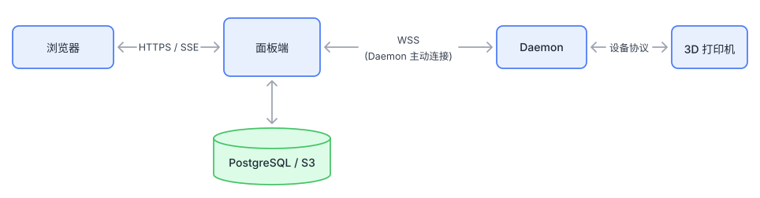

<div align="center">

# PlateRelay

[![Contract CI][ci-shield]][ci-url]
[![Status][status-shield]][status-url]
[![Last Commit][last-commit-shield]][last-commit-url]
[![Stargazers][stars-shield]][stars-url]
[![Issues][issues-shield]][issues-url]
[![PRs Welcome][prs-shield]][prs-url]
[![License][license-shield]][license-url]

面向黑客松、创客空间、高校实验室等共享打印机场景的开源自托管 3D 打印平台，提供多机集中管控以及可审计的审核、调度与成品交付流程，将用户与物理打印设备隔离。

[快速开始](#快速开始) · [开发路线图](#开发路线图) · [报告问题](https://github.com/TomChicken-on-github/PlateRelay/issues/new) · [功能建议](https://github.com/TomChicken-on-github/PlateRelay/issues/new)

[English](README.md) · **简体中文**

</div>

<details>
  <summary>目录</summary>
  <ol>
    <li>
      <a href="#关于项目">关于项目</a>
      <ul>
        <li><a href="#技术栈">技术栈</a></li>
        <li><a href="#仓库结构">仓库结构</a></li>
      </ul>
    </li>
    <li>
      <a href="#快速开始">快速开始</a>
      <ul>
        <li><a href="#部署运行">部署运行</a></li>
        <li><a href="#本地开发">本地开发</a></li>
      </ul>
    </li>
    <li><a href="#开发路线图">开发路线图</a></li>
    <li>
      <a href="#参与贡献">参与贡献</a>
      <ul>
        <li><a href="#贡献者">贡献者</a></li>
      </ul>
    </li>
    <li><a href="#版权与许可证">版权与许可证</a></li>
    <li><a href="#联系方式">联系方式</a></li>
    <li><a href="#致谢">致谢</a></li>
  </ol>
</details>

## 关于项目

**PlateRelay** 将多机集中管控与共享打印工作流相结合。与面向单方私有集群的传统打印农场系统不同，PlateRelay 专为多方共享的公共打印资源设计：

| 维度 | 传统打印农场系统 | PlateRelay |
| --- | --- | --- |
| 资源属性 | 单方私有集群 | 多方共享的公共打印资源 |
| 角色隔离 | 内部人员直接操作设备 | 普通用户仅提交打印文件与凭码取件，与物理设备隔离 |
| 调度与审计 | 内部直接排产，缺乏审核与操作审计 | 人工审核、规则化队列调度与操作审计，可见范围可按权限配置 |
| 交付闭环 | 打印结束即终止，无交付与清床约束 | 成品入库并确认清床后释放设备，凭码核销交付 |

<p align="center">
  <picture>
    <source media="(prefers-color-scheme: dark)" srcset="docs/assets/workflow-dark.svg">
    <source media="(prefers-color-scheme: light)" srcset="docs/assets/workflow-light.svg">
    
  </picture>
</p>

系统采用**管理面板**与**局域网守护进程（daemon）**分离的架构：daemon 部署于打印机所在局域网并主动连接面板，无需开放内网入站端口；设备接入层通过统一适配器接口抽象不同品牌机型，确保核心业务流程与具体设备品牌解耦。

<p align="center">
  <picture>
    <source media="(prefers-color-scheme: dark)" srcset="docs/assets/architecture-dark.svg">
    <source media="(prefers-color-scheme: light)" srcset="docs/assets/architecture-light.svg">
    
  </picture>
</p>

### 技术栈

[![NestJS][nestjs-shield]][nestjs-url]
[![Node.js][nodejs-shield]][nodejs-url]
[![TypeScript][typescript-shield]][typescript-url]
[![React][react-shield]][react-url]
[![Vite][vite-shield]][vite-url]
[![Tailwind CSS][tailwind-shield]][tailwind-url]
[![PostgreSQL][postgresql-shield]][postgresql-url]
[![Python][python-shield]][python-url]

### 仓库结构

| 目录 | 说明 |
| --- | --- |
| [`apps/server`](apps/server/README.md) | 面板后端服务（REST API、SSE 推送、daemon 控制通道） |
| [`apps/web`](apps/web/README.md) | 面板前端应用（当前以本地模拟数据原型为主） |
| [`daemon`](daemon/README.md) | 局域网设备守护进程与内置模拟打印机 |
| [`packages/shared`](packages/shared/schema/openapi.yaml) | 跨端共享类型、OpenAPI 与 daemon 通信协议契约 |
| `docs` | 设计规约、交互时序图与硬件实测记录 |
| [`tools`](tools/printer_mcp/README.md) | 硬件只读探测与调试工具 |

## 快速开始

### 部署运行

项目当前处于早期开发阶段，暂未发布生产可用的安装包与 Docker Compose 部署方案。现阶段可通过下方的本地开发环境预览前端原型，或使用内置模拟打印机进行后端与守护进程联调。

### 本地开发

#### 环境要求

- **面板前后端**：Node.js `>= 24`、`pnpm`（本地开发默认使用内置 PGlite 与本地存储，无需额外配置数据库或对象存储）
- **守护进程与模拟打印机（可选）**：Python `>= 3.12`、`uv`

#### 安装依赖

```sh
pnpm install
uv sync --project daemon   # 仅运行前端或后端时可省略
```

#### 启动服务

在仓库根目录执行：

```sh
# 前端原型（使用本地模拟数据，默认访问 http://localhost:5173/）
pnpm dev:web

# 面板后端（默认监听 :3000）
pnpm dev:server
```

> [!NOTE]
> 面板后端已按新版契约实现核心流程，前端正在同步适配中，当前 `apps/web` 的 `VITE_API=http` 模式暂不可用。如需进行「面板后端 + 模拟打印机 + daemon」三端联调，请参阅 [apps/server/README.md](apps/server/README.md) 与 [daemon/README.md](daemon/README.md)。

#### 运行测试

```sh
pnpm test                                   # 共享包与面板后端测试
uv run --project daemon pytest daemon/tests # daemon 与模拟打印机测试
```

## 开发路线图

- [x] **核心契约与基础框架**：完成 OpenAPI 与 daemon 通信协议、面板后端核心工作流、守护进程框架与内置模拟打印机
- [ ] **v1 完整可用**：完成前端适配、完整文件安全校验、拓竹设备驱动、媒体能力、外部登录与通知，以及 Docker Compose 部署方案
- [ ] **多品牌设备驱动**：扩展 Klipper / Moonraker、PrusaLink、OctoPrint 等主流固件与协议支持
- [ ] **场地运营与成本管理**：成品暂存库位管理、耗材库存管理、用量统计报表与费用追踪
- [ ] **开放集成**：完善公开 REST API、受限权限的个人访问令牌（PAT）、事件 Webhook 与外部认证/通知扩展，便于对接赛事平台、高校或社区系统

## 参与贡献

欢迎通过 Issue 反馈问题或提交 Pull Request。提交代码前请注意：

1. 涉及接口或 daemon 协议变更时，请先更新 `packages/shared/schema/` 下的契约文件并同步生成代码。
2. 提交前请确保 `pnpm test` 与 `uv run --project daemon pytest daemon/tests` 全部通过。
3. 严禁在代码、配置文件、日志或测试中写入真实打印机访问码、密钥或凭据。

标准协作流程：Fork 本仓库 → 创建特性分支（`git checkout -b feat/your-feature`）→ 提交更改 → 发起 Pull Request。

### 贡献者

<p>
  <a href="https://github.com/TomChicken-on-github/PlateRelay/graphs/contributors">
    
  </a>
  
  
  <a href="https://github.com/belugaQAQ">
    
  </a>
  <a href="https://github.com/z4zhishi">
    
  </a>
</p>

## 版权与许可证

Copyright (C) 2026 Tom_Chicken

PlateRelay 是自由软件，按 GNU 通用公共许可证第 3 版（[GPL-3.0-only](LICENSE)）发布。本程序不附带任何担保，详见许可证全文。

### 第三方代码

| 组件 | 位置 | 版权 | 许可证 |
| --- | --- | --- | --- |
| [ha-bambulab](https://github.com/greghesp/ha-bambulab) 的 pybambu | [daemon/src/platerelay_daemon/adapters/bambu/_vendor/pybambu/](daemon/src/platerelay_daemon/adapters/bambu/_vendor/pybambu/) | Copyright (c) 2023 ha-bambulab contributors | MIT，原文见 [LICENSE](daemon/src/platerelay_daemon/adapters/bambu/_vendor/pybambu/LICENSE) |

PlateRelay 与拓竹（Bambu Lab）、ha-bambulab 项目均无关联。

## 联系方式

- 问题反馈与功能建议：[GitHub Issues](https://github.com/TomChicken-on-github/PlateRelay/issues)
- 项目仓库：[TomChicken-on-github/PlateRelay](https://github.com/TomChicken-on-github/PlateRelay)

## 致谢

- [ha-bambulab](https://github.com/greghesp/ha-bambulab)（`pybambu`）
- [Best-README-Template](https://github.com/othneildrew/Best-README-Template)

<!-- MARKDOWN LINKS & IMAGES -->
[ci-shield]: https://img.shields.io/github/actions/workflow/status/TomChicken-on-github/PlateRelay/contract.yml?branch=main&style=for-the-badge&logo=githubactions&logoColor=white&label=Contract%20CI
[ci-url]: https://github.com/TomChicken-on-github/PlateRelay/actions/workflows/contract.yml
[status-shield]: https://img.shields.io/badge/Status-Early%20Development-orange?style=for-the-badge
[status-url]: #开发路线图
[last-commit-shield]: https://img.shields.io/github/last-commit/TomChicken-on-github/PlateRelay?style=for-the-badge
[last-commit-url]: https://github.com/TomChicken-on-github/PlateRelay/commits/main
[stars-shield]: https://img.shields.io/github/stars/TomChicken-on-github/PlateRelay?style=for-the-badge
[stars-url]: https://github.com/TomChicken-on-github/PlateRelay/stargazers
[issues-shield]: https://img.shields.io/github/issues/TomChicken-on-github/PlateRelay?style=for-the-badge
[issues-url]: https://github.com/TomChicken-on-github/PlateRelay/issues
[prs-shield]: https://img.shields.io/badge/PRs-welcome-brightgreen?style=for-the-badge
[prs-url]: #参与贡献
[license-shield]: https://img.shields.io/badge/License-GPL--3.0--only-blue?style=for-the-badge
[license-url]: LICENSE

[nestjs-shield]: https://img.shields.io/badge/NestJS-E0234E?style=for-the-badge&logo=nestjs&logoColor=white
[nestjs-url]: https://nestjs.com/
[nodejs-shield]: https://img.shields.io/badge/Node.js-339933?style=for-the-badge&logo=nodedotjs&logoColor=white
[nodejs-url]: #环境要求
[typescript-shield]: https://img.shields.io/badge/TypeScript-3178C6?style=for-the-badge&logo=typescript&logoColor=white
[typescript-url]: https://www.typescriptlang.org/
[react-shield]: https://img.shields.io/badge/React-20232A?style=for-the-badge&logo=react&logoColor=61DAFB
[react-url]: https://react.dev/
[vite-shield]: https://img.shields.io/badge/Vite-646CFF?style=for-the-badge&logo=vite&logoColor=white
[vite-url]: https://vite.dev/
[tailwind-shield]: https://img.shields.io/badge/Tailwind%20CSS-06B6D4?style=for-the-badge&logo=tailwindcss&logoColor=white
[tailwind-url]: https://tailwindcss.com/
[postgresql-shield]: https://img.shields.io/badge/PostgreSQL-4169E1?style=for-the-badge&logo=postgresql&logoColor=white
[postgresql-url]: https://www.postgresql.org/
[python-shield]: https://img.shields.io/badge/Python-3776AB?style=for-the-badge&logo=python&logoColor=white
[python-url]: #环境要求
